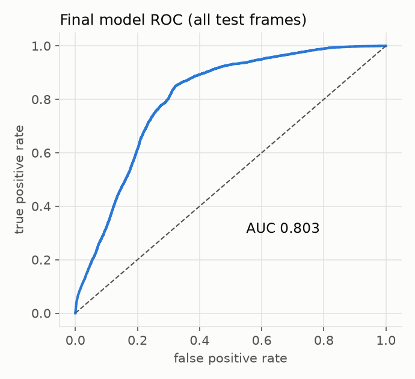
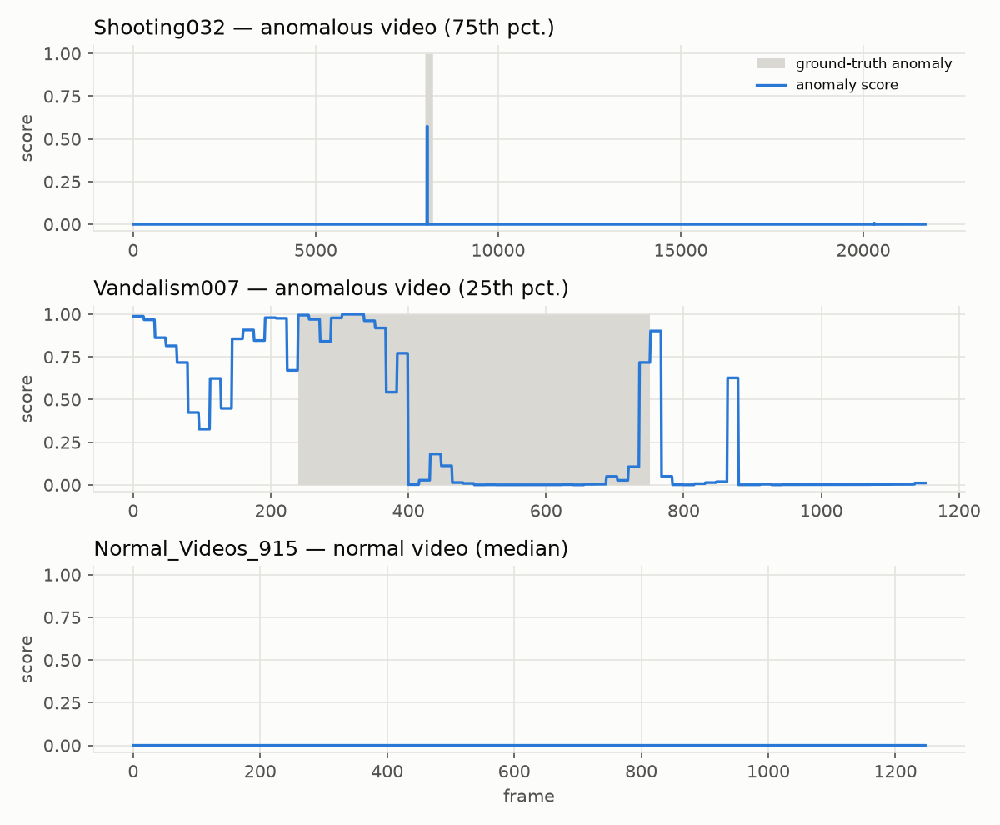

# AI Surveillance: Weakly-Supervised Video Anomaly Detection + Real-Time Tracking

Two parts. The first detects **anomalous events** (robbery, assault, road accidents…) in CCTV video when only *video-level* labels exist for training (UCF-Crime benchmark). The second **tracks people in real time** and raises rule-based alerts (loitering, crowding).

**Live demo:** https://huggingface.co/spaces/vedpawar/ai-surveillance-demo (free Hugging Face ZeroGPU tier; the first load after idle takes about a minute)

| Headline (all measured in this repo, see `reports/`) | Value |
|---|---|
| UCF-Crime test **frame-level ROC AUC** (290 videos, 1.11M frames) | **0.802 ± 0.005** (5 seeds; final model 0.803) |
| False alarms on normal videos (score > 0.5) | 2.1% of frames |
| Person detection + tracking speed, laptop CPU (Apple M1) | **23.8 FPS** (real time for a 10 FPS camera) |
| Same pipeline on the live demo (free ZeroGPU, CUDA) | **53.6 FPS** (300 frames, measured on the live Space) |
| Tests | 21 passing |

---

## How it works

```
                         ┌────────────── Part 1: anomaly detection (offline, benchmarked) ──────────────┐
UCF-Crime video  ──►  I3D features (precomputed, 2048-d)  ──►  MLP scorer  ──►  anomaly score per 16 frames
                      train: 32 segments per video              2048→512→32→1        │
                      test:  one per 16-frame clip              trained with          ▼
                                                                MIL ranking loss   frame-level ROC AUC

                         ┌────────────── Part 2: real-time tracking (runs on any video) ────────────────┐
camera / video  ──►  YOLOv8n (people, 320 px)  ──►  ByteTrack (persistent IDs)  ──►  rules  ──►  events JSON
                     23.8 FPS on M1 CPU             same person = same ID           loitering > 20 s
                                                                                     crowd ≥ 8 for ≥ 2 s
```

**Why these choices**
- **Multiple-instance learning (MIL), because labels are weak.** UCF-Crime says *whether* a training video contains a crime, never *when*. MIL treats each video as a "bag" of 32 segments and trains with a ranking loss: the highest-scoring segment of an anomalous video must outscore the highest-scoring segment of a normal video by a margin (Sultani, Chen & Shah, CVPR 2018). Two regularisers encode the priors that anomalies are *short* (sparsity) and *contiguous* (smoothness). Written from the paper in [`surveillance/model.py`](surveillance/model.py).
- **Precomputed I3D features + a small MLP.** Extracting I3D features from about 100 GB of raw video needs a GPU cluster. The community-standard features let a 1M-parameter model train in about 6 minutes on a laptop CPU.
- **Model selection on validation, evaluation on test exactly once.** 10% of *training* videos are held out (video-level labels only). The best epoch and the final model are picked there. Test frame labels are used only to report.
- **Tracking, not just detection.** Detection answers "is there a person in this frame?". Loitering needs "has *this* person been here for 20 s?", which needs identity over time, so ByteTrack goes on top of YOLO.
- **YOLOv8n at 320 px on CPU.** It was the only configuration measured to keep up with the camera on a laptop (table below). On this machine, the M1 GPU was *slower* than the CPU for one-frame-at-a-time inference.

## Data

- **UCF-Crime I3D features** (RGB, ten-crop, 2048-d) from the Hugging Face mirror [`jinmang2/ucf_crime_tencrop_i3d_seg32`](https://huggingface.co/datasets/jinmang2/ucf_crime_tencrop_i3d_seg32/tree/tushar-n). That's 1610 training videos (800 normal / 810 anomalous, 13 crime types) and 290 test videos (150 / 140) with per-frame ground truth. **Only 7.6% of test frames are anomalous**, which is why the metric is ROC AUC, not accuracy.
- **Sample video** for tracking: OpenCV's `vtest.avi` (Apache-2.0, 768×576, 10 fps, 80 s of pedestrians).
- Sources, layouts, verified counts and download commands are in [`data/README.md`](data/README.md). Nothing in `data/` is committed.

## Results

### Anomaly detection (UCF-Crime test set)

| Variant (5 seeds each) | Frame AUC | AUC inside anomalous videos only | False-alarm rate @ 0.5 |
|---|---|---|---|
| **Top-1 MIL** (the paper's loss) | **0.802 ± 0.005** | 0.597 | 2.2% |
| Top-3 MIL (average of the 3 highest segments) | 0.804 ± 0.002 | 0.597 | 3.3% |

The final model is top-1, seed 3, **picked on validation** (val video-AUC 0.925). It scores 0.803 test frame-AUC and is saved as `models/final.pt` (4 MB).

For context, as reported in the literature: Sultani et al. with C3D features got 0.754. The RTFM paper (Tian et al., ICCV 2021) lists Sultani-style MIL on I3D-RGB at about 0.78 and RTFM itself at 0.843. This re-implementation lands where an honest MIL baseline on I3D-RGB features should.

| | |
|---|---|
|  |  |
| **Top-k ablation:** the 0.002 gap is inside the seed-to-seed spread, so it's a tie on accuracy. Top-3 is more stable (std 0.002 vs 0.005)… | **ROC** of the final model over all 1.11M test frames. |
|  |  |
| …and converges in about 20 epochs instead of about 60 (validation curves, 5 seeds). | **Score timelines**, picked by a fixed rule (25th/75th-percentile anomalous video, median normal video), not cherry-picked. The gray band is the ground truth. |

### Real-time detection + tracking (Apple M1 laptop, CPU unless noted)

| Configuration | FPS | Notes |
|---|---|---|
| **YOLOv8n @ 320 + ByteTrack + rules (default)** | **23.8** | 5.61 people tracked per frame, 47 track IDs |
| YOLOv8n @ 640 + ByteTrack + rules | 6.5 | 5.83 people tracked per frame, 40 track IDs (steadier tracks) |
| YOLOv8n @ 640, detection only | 7.3 | |
| YOLOv8s @ 640, detection only | 2.9 | |
| YOLOv8x @ 640, detection only (the 2025 model) | 0.87 | |
| YOLOv8n @ 640 on the M1 GPU (MPS), detection only | 0.99 | slower than CPU; hung in 2 earlier runs |

The **320 vs 640 tradeoff**: 320 is 3.6× faster and loses only 4% of detected people. But tracks break more often (47 IDs vs 40), and broken tracks restart the loitering timer, so on the sample video it found 6 loitering events instead of 7 and missed the one borderline crowd event. Raw numbers are in `reports/detector_fps.json` and `reports/detector_tradeoff.json`.

### Operator alerts (LLM layer)

Tracking produces timestamped events. `surveillance/summarize.py` turns them into a short triage note, so an operator reviews only the seconds that matter instead of the whole recording:

1. **Code** pads each event by 2 s, merges overlapping windows, and computes *review time* and *% of footage saved*.
2. **An LLM** (Groq `gpt-oss-20b`, with Gemini `3.5-flash-lite` as the fallback, both on free tiers) gets *only those facts as JSON* and writes 2–4 sentences. It never sees the video, and the prompt forbids anything not in the facts.
3. **Code** appends the exact review windows after the LLM text, so the actionable part never depends on the LLM. If both providers fail, or a daily cap of 200 calls is hit, a template note is used instead.

Measured on the live sample: Groq and Gemini each answered in about 0.7 s, citing the right track and times. On that 30 s clip the saving is only 5%, because one person loiters for almost the whole clip. The approach pays off on long footage with sparse events (e.g., 28 s to review out of 100 s = 72% saved, in `tests/test_summarize.py`).

### Before vs after

| | 2025 capstone version | This rebuild |
|---|---|---|
| Runs? | No: `main.py` TabError, `rcnn.py` IndentationError, `learner.py` missing, no data | Yes: clean install + documented commands |
| Anomaly AUC | "84.45%", copied with its comparison table from another repo's README; measured by averaging per-pair AUCs over randomly paired videos | **0.802 ± 0.005**, standard pooled frame-level AUC, 5 seeds, validation-based selection |
| Anomaly model | described as a "custom I3D two-stream model" | an MLP on precomputed I3D-RGB features, described as such |
| Detection numbers | YOLOv8 "mAP 82–85%, 45–60 FPS", Faster R-CNN "88–92%". No training or evaluation code existed. | No mAP claimed (pretrained COCO, no annotated surveillance set). FPS measured on this machine. |
| Events / alerts | described, not implemented | loitering + crowd events from tracks, unit-tested |
| Tests | none | 17 |

The same trained models scored with the 2025 per-pair metric give 0.786–0.790, not the same as the standard number and not comparable to published results. `tests/test_evaluate.py` shows why: per-pair averaging can't see a normal frame in one video outscoring an anomalous frame in another. A single alarm threshold across cameras has to handle exactly that case.

## Built under constraints

Every number above was produced on free or personal hardware. These limits shaped the design. Each row says what I did about one, and what lifting it would unlock.

| Constraint | What I did about it | What lifting it would unlock |
|---|---|---|
| **No GPU for development**: one Apple M1 laptop, 16 GB RAM | Small models (1M-parameter MLP, YOLOv8n), CPU-first code. Trained 10 models (~6 min each) on CPU. Benchmarked every detector config instead of assuming. | YOLOv8s/m at 640 px in real time; feature extraction from raw video |
| **The M1 GPU (MPS) was unusable**: it hung twice and ran 7× slower than CPU for frame-by-frame inference | Defaulted to CPU, and isolated each benchmark config in its own process so a hang can't block the rest | Batched GPU inference |
| **About 10–14 GB of free disk** (it filled up completely mid-project) | Read features straight from the zips (no 10 GB extraction), cached crop-averaged arrays (~1 GB), deleted the zips once cached | The raw UCF-Crime videos (~100 GB) |
| **The original data was lost**, and raw video was too big | Rebuilt on public precomputed I3D features (RGB only, no optical flow), with provenance documented | A two-stream (RGB + flow) model; end-to-end scoring of new videos |
| **Free hosting**: Hugging Face ZeroGPU, a GPU only per request within a daily quota, plus a forced torch ≤ 2.13 | Uploads capped at 30 s; only detection/tracking runs inside the GPU slot (video re-encoding stays outside); package dependencies declared as ranges so they install alongside the host's PyTorch | Always-on GPU, longer videos, concurrent users |
| **Free LLM tiers**: rate limits, models retired without notice (Llama 3.3 vanished from Groq; Gemini 2.5 Flash closed to new users; Gemini 3.8 Flash timed out at 20 s) | Provider-agnostic OpenAI-compatible client, Groq → Gemini → template fallback, model names overridable by env var, daily call cap | A dedicated, SLA-backed model endpoint |
| **No labelled event data** for loitering/crowding | Hand-set, documented thresholds; event logic unit-tested with synthetic tracks | Tuned and measured alert precision/recall |

**The result under these limits:** a benchmarked anomaly detector at 0.80 frame-AUC, comparable to published MIL baselines, plus a tracker that runs in real time on a laptop CPU and at 53.6 FPS on a free shared GPU. Every number is reproducible from the commands below.

## Project structure

```
surveillance/
  config.py       all paths, constants and thresholds (single source of truth)
  download.py     fetch the UCF-Crime feature zips (resumable)
  data.py         read features from the zips, crop-average, cache, assert counts/shapes/alignment
  model.py        MLP scorer + MIL ranking loss (top-k option)
  train.py        paired-bag training, epoch selection on validation video-AUC
  evaluate.py     pooled frame-level AUC, anomalous-only AUC, false-alarm rate, the 2025 metric
  experiment.py   seeds x variants grid: train, then evaluate on test once
  report.py       aggregate runs -> reports/metrics.json + charts, pick final model on validation
  detect.py       YOLOv8 + ByteTrack + EventDetector (loitering, crowd), streaming
  benchmark.py    detector FPS per config, one subprocess each (isolates hangs)
  export_scores.py  final model's per-clip test scores -> reports/test_scores.json (for the demo)
  summarize.py    events -> review windows + % footage saved (code) + LLM operator note (Groq -> Gemini -> template)
space/            Hugging Face Space wrapper: app.py (Gradio), requirements.txt, packages.txt, README.md
tests/            21 tests: data, loss, metrics, event rules, alert summaries
models/final.pt   the selected anomaly model (4 MB)
reports/          metrics.json, test_scores.json, detector_fps.json, detector_tradeoff.json, charts
data/README.md    data sources and download instructions (data itself not committed)
pyproject.toml    makes `surveillance` pip-installable (dependency ranges); requirements.txt = exact pins
```

## Run locally

Python 3.12. These are the exact commands run in this rebuild.

```bash
pip install -r requirements-dev.txt          # runtime: requirements.txt; dev adds matplotlib + pytest
python -m pytest                             # 21 tests (one is skipped if the dataset isn't downloaded)
```

Real-time tracking on the sample video (no dataset needed):

```bash
mkdir -p data/samples && curl -L -o data/samples/vtest.avi https://raw.githubusercontent.com/opencv/opencv/4.x/samples/data/vtest.avi
python -m surveillance.detect --save-video    # -> outputs/vtest_events.json, outputs/vtest_tracked.mp4
python -m surveillance.benchmark              # -> reports/detector_fps.json
```

Reproduce the anomaly results (about 10 GB download; the zips can be deleted after caching):

```bash
python -m surveillance.download               # feature zips + ground truth -> data/ucf_crime/
python -m surveillance.data                   # build caches, print verified counts
python -m surveillance.experiment --k 1       # 5 seeds, ~6 min each on an M1 CPU
python -m surveillance.experiment --k 3
python -m surveillance.report                 # -> reports/metrics.json, charts, models/final.pt
```

## Deployment

**Hugging Face Spaces (Gradio SDK, free ZeroGPU hardware):** https://huggingface.co/spaces/vedpawar/ai-surveillance-demo

```
Space repo (text files only: space/*)          GitHub repo (this one)
  app.py ── pip install ai-surveillance @ git+https://github.com/...@main
         ── fetches reports/test_scores.json + metrics.json (raw GitHub URLs)
         ── fetches the sample video from OpenCV
```

- **Why the Space holds only a wrapper:** Hugging Face rejects binary files committed with plain git, and this repo has PNGs and `final.pt` in its history. The Space installs the package from GitHub, so GitHub stays the single source of truth.
- **Tabs:** *Live tracking* (upload ≤ 30 s, or use the sample, to get the tracked video + events), *Anomaly explorer* (score vs. ground truth for all 290 test videos, precomputed from `final.pt`), *About & constraints*.
- **GPU use:** only detection + tracking run inside `@spaces.GPU`. The same code falls back to CPU anywhere else.
- **To update:** push to GitHub, then rebuild the Space (Settings → Factory rebuild, or upload a changed `space/` file).
- Local run of the same app: `pip install -e . gradio matplotlib && python space/app.py`.

## Limitations

- **Localization is weak.** Within crime videos, the AUC for *when* the crime happens is only 0.60. Most of the 0.80 comes from separating crime videos from normal ones. That's typical of weakly-supervised MIL, and it's the main thing newer methods (RTFM, MGFN) improve on.
- **RGB only.** This feature release has no optical-flow stream, so motion is captured only through I3D's 3D convolutions.
- **The anomaly model can't score a new raw video yet.** That needs the *same* I3D-ResNet50 feature extractor the dataset used. A different extractor would create a training/serving mismatch that silently breaks the model.
- **Unofficial data mirror.** The features come from a single-contributor Hugging Face upload. Counts, shapes and ground-truth alignment are all verified on load, but the files aren't checksummed against an official release.
- **Event rules are hand-set** (20 s, 8 people, 2 s) and evaluated on a single sample video, with no labelled ground truth for events. Some low-confidence false positives get through (e.g., a sign detected as a person at 0.30).
- **Hardware-specific numbers.** All FPS figures are from one M1 laptop.
- **Licensing:** Ultralytics YOLOv8 is AGPL-3.0, which matters if this is ever deployed as a service.

## Learning log: mistakes and what I learned

Built in layers; each records what went wrong and the lesson.

### Layer 1 - VIT capstone (2024–25, report dated April 2025; Ultralytics YOLOv8, torchvision Faster R-CNN, PyTorch)

*What I built:* a capstone report and poster describing a three-model surveillance system (YOLOv8, Faster R-CNN, an "I3D two-stream" anomaly model) with alerts, a dashboard, edge deployment and a cost/ROI analysis. The code behind it was three short scripts.

| # | Mistake | What actually happened | Lesson |
|---|---|---|---|
| 1.1 | **Borrowed code and headline number, no attribution** | `main.py`, `dataset.py` and `loss.py` (and the missing `learner.py`) match an open-source PyTorch re-implementation of Sultani et al. The "84.45% vs RTFM 84.03% vs C3D 75.41%" table is that repo's README table, reported as our result. | Using open-source code is normal; presenting its numbers as yours isn't. Cite it, then measure your own. |
| 1.2 | **Called a 3-layer MLP a "custom I3D model"** | The trained part was `Linear(2048→512→32→1)` on features someone else had extracted with I3D. | Describe the system you actually built. "MLP on precomputed I3D features" is still a good project. |
| 1.3 | **Non-standard, non-deterministic evaluation** | AUC was computed per (anomalous, normal) video pair and averaged over 140 *randomly shuffled* pairs, and the test set was evaluated after every epoch. | Use the benchmark's protocol (pooled frame-level AUC), fix seeds, and never select on test. |
| 1.4 | **Numbers with no code behind them** | YOLOv8 "retrained on SPHAR's 14 classes, mAP 82–85%", Faster R-CNN "88–92%". The scripts only ran pretrained COCO models; the "14 classes" listed were UCF-Crime's; the poster said R-CNN runs at 15–20 FPS and the report said 7–8. | Every number needs a script and an output file that produced it. |
| 1.5 | **Hard-coded environment** | `path='/workspace/DATA/UCF-Crime/'`, and `.cuda()` on every tensor in the loss, so it couldn't run on a CPU or another machine. | Paths and devices go in config; the code shouldn't assume one machine. |
| 1.6 | **Unbounded memory on video** | `model.predict('input_videos/neutral1.mp4', save=True)` collects every frame's results in one list. | Stream frames (`stream=True`); a camera never stops. |
| 1.7 | **Report described features that didn't exist** | Email/SMS alerts, a dashboard, Jetson deployment and a "$135k–190k development cost" analysis, none of it in code. | Scope the write-up to what runs; list the rest as future work. |

### Layer 2 - Putting it on GitHub (Nov 8–10, 2025)

*What I built:* a repo with the scripts copied out of the report's code appendix, a README and the architecture diagram.

| # | Mistake | What actually happened | Lesson |
|---|---|---|---|
| 2.1 | **Copied code out of a PDF** | The indentation broke: `main.py` failed with `TabError` at line 43 and `rcnn.py` with `IndentationError` at line 59. Nothing in the repo could run. | Push from the working source, and run it once from a fresh clone. |
| 2.2 | **Incomplete repo** | `learner.py` was never committed. There was no `requirements.txt` and no data, and the README pointed to `rcnn/rcnnInference.py` and `i3d_two_stream/main.py`, which didn't exist. | A repo is only reproducible if someone else can run it from the README. |
| 2.3 | **Data not preserved** | The features came from a shared zip that's now gone, with no record of its exact source. | Record data provenance (URL, version, size, counts) the day you download it. |

### Layer 3 - The rebuild (November 2026)

*What I did:* threw away the broken scripts and rebuilt the project as a tested package on public data, with my own implementation, honest evaluation and measured speeds.

| # | Decision | Why |
|---|---|---|
| 3.1 | Public Hugging Face feature mirror, documented in `data/README.md` with sizes, layouts and verified counts | Replaces the lost data, and anyone can reproduce it (fixes 2.3). |
| 3.2 | Read features straight from the zips, crop-average them, cache them, and **assert counts, shapes and frame alignment** | The shape check caught on its first run that train is `(crops, 32 segments, dim)` but test is `(clips, crops, dim)`. Averaging the wrong axis would have silently produced garbage. |
| 3.3 | MIL ranking loss written from the paper, with sources credited | My own code, honestly described (fixes 1.1, 1.2). |
| 3.4 | Validation split from training videos (video labels only); test evaluated once per model | No selection on test (fixes 1.3). |
| 3.5 | Pooled frame-level AUC, 5 seeds, mean ± std, plus the 2025 metric reproduced for comparison | A number comparable to the literature, with honest uncertainty (fixes 1.3). |
| 3.6 | Top-k ablation, reported as a tie | 0.804 vs 0.802 is inside the noise; the real gain is stability and faster convergence. |
| 3.7 | YOLOv8n + ByteTrack + tested rule-based events, streaming | Turns detection into alerts an operator can use, with flat memory (fixes 1.6, 1.7). |
| 3.8 | FPS benchmark per config in isolated processes; 320 px CPU as the default | Real numbers from real hardware (fixes 1.4). Exposed that the 2025 model runs at 0.87 FPS and that MPS was slower than CPU. |
| 3.9 | `config.py`, pinned requirements, 17 tests, clean-install check | Runs on any machine from the README (fixes 1.5, 2.1, 2.2). |

*Known gaps I chose not to fix:* RGB-only features (no flow stream), no end-to-end anomaly scoring on raw video (needs the matching I3D extractor), weak temporal localization (0.60), event thresholds not validated against labelled events, an unofficial data mirror.

### Layer 4 - Deploying under constraints (November 2026, Hugging Face Spaces, Gradio)

*What I built:* a public demo on Hugging Face's free ZeroGPU tier, plus packaging so the Space installs the tested code from GitHub.

| # | Mistake | What actually happened | Lesson |
|---|---|---|---|
| 4.1 | **Used exact pins as package dependencies** | `pyproject.toml` read `requirements.txt`, so the package demanded `torch==2.15.0`. ZeroGPU forces `torch<=2.13.0`, and the build failed with `ResolutionImpossible`. Fixed with ranges (`torch>=2.2`), verified by resolving the Space's exact install for Linux locally, and re-running the tests on torch 2.13 (same 0.8032 AUC). | A *package* declares compatible ranges; an *app* pins exact versions in a lock file. Don't use one file for both. |
| 4.2 | **Assumed ZeroGPU would just run a CPU app** | The build passed, then the runtime stopped the app with `No @spaces.GPU function detected during startup`. Fixed by wrapping only detection + tracking in `@spaces.GPU`, with a CPU fallback. | Read the platform's runtime contract, not just its build docs. |
| 4.3 | **Let the disk fill up mid-project** | With 10 GB of zips plus caches on a nearly full laptop, commands failed with `ENOSPC`. The zips weren't needed once the caches existed. | Know which artifacts are raw inputs and which are derived, and delete what can be re-derived or re-downloaded. |
| 4.4 | **Nearly shipped a video browsers can't play** (caught locally) | OpenCV writes MPEG-4 Part 2 (`mp4v`), which browsers won't play. The app re-encodes to H.264 with ffmpeg, which `packages.txt` installs on the Space. | Test the demo in a real browser before deploying. |
| 4.5 | **Hard-coded LLM model names from memory** | The first test returned 404 from both providers: Groq no longer serves Llama 3.3, and Gemini 2.5 Flash is closed to new users. The fallback chain still produced a (template) answer. Fixed by checking each provider's `/models` list and picking current, fast models. | Hosted models get retired; verify against the live model list, make names configurable, and always have a non-LLM fallback. |

### Key takeaways

1. **A number without a script is a claim, not a result.** Every metric here traces back to a file in `reports/`.
2. **The evaluation protocol is part of the result.** The same model scores 0.79 or 0.80 depending on how you average, and only one of those is comparable to papers.
3. **Assert your data's shape before you trust it.** One assertion caught a train/test layout mismatch that would have silently ruined training.
4. **"Real time" depends on the hardware.** The model the report claimed ran at 45–60 FPS runs at 0.87 FPS on a laptop. Resolution and model size are the knobs, and each has a measurable cost.
5. **An honest 0.80 beats a borrowed 0.84.** It survives questions in an interview.
6. **Constraints are design inputs.** No GPU, a nearly full disk and free hosting decided the model sizes, the data format and the deployment architecture. Naming them, and what lifting each would unlock, is part of the result.

## Future improvements

- Run the alert LLM locally (a small open model on the Space's GPU), so no event data leaves the deployment: the privacy-first option for real CCTV.
- Score raw video end to end using the matching I3D-ResNet50 extractor.
- Try a stronger weakly-supervised method (RTFM-style feature magnitudes) to improve localization.
- Label a few events on real footage to tune and evaluate the alert rules.

## Credits

- Sultani, Chen & Shah, *Real-world Anomaly Detection in Surveillance Videos*, CVPR 2018 (the method and the UCF-Crime dataset).
- Tian et al., *RTFM*, ICCV 2021 (I3D feature release and comparison numbers).
- The `jinmang2` Hugging Face feature upload; OpenCV's `vtest.avi`.
- Ultralytics YOLOv8 (AGPL-3.0) and ByteTrack (Zhang et al., ECCV 2022).
- The 2025 version began as a VIT capstone project (School of Computer Science and Engineering, April 2025). This rebuild is a complete rewrite.
